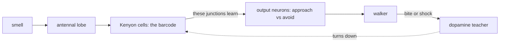

# The brain learned first; the fly improved only when its walker could use it

*Teaching a simulated fly to find food and dodge a trap took a run of failures, and the last fix was a bug in who got the credit.*

In our first pain experiment the trap smell fell from a score of +0.77 to +0.08 inside the fly's brain. The fly kept walking into the trap anyway. Its behaviour was no better than an untrained twin's (p = 0.80).

The brain had learned. The walker, the little program that turns brain output into steps, could not use it. This article follows that gap from a brain that flooded, to a brain that learned, to a fly that finally acted on it.

## A library of smells with a teacher attached

Last time we met the **mushroom body**. Here is what it does. About 5,000 **Kenyon cells** each respond to some mix of smells, so every odour switches on its own pattern, like a barcode. Those cells connect to about 60 **output neurons** that vote: some vote "go toward this", some "get away from this". The fly's choice is roughly the sum of the votes.

Learning happens at the junction between a Kenyon cell and an output neuron. A **dopamine** neuron acts as the teacher. When food arrives, the teacher fires and turns down the "get away" vote for whichever smell was active a moment ago. When a shock arrives, the punishment teacher turns down the "go toward" vote instead. Next time that smell comes, the balance has shifted.

In our model only this one set of junctions learns. Every other wire stays exactly as the connectome says.

## Problem one: every smell made the same barcode

On the authors' brain, by 200 milliseconds about 3,400 of the 5,177 Kenyon cells fire for every odour. Compare two odours with an overlap score from 0 (no shared cells) to 1 (identical sets). Ours read 0.98. The barcodes were the same barcode.

That ruins teaching. Reward smell A and you turn down the votes of cells that smell B uses too. In our first test, B's response moved as much as A's.

Earlier tuning had found no setting that gave sparse barcodes and live output neurons together. This time we asked where the flood started. The answer was upstream. The first relay after the nose, the antennal lobe, was already 66 percent active at 30 milliseconds. The flood was in the signal before it reached the mushroom body.

We multiplied the strength of the inhibitory connections from the antennal lobe's local cells by 12. Kenyon cell activity fell to 6.2 percent. The overlap score between two odours fell to 0.19. The output neurons stayed alive. Boosting the main inhibitory cell of the mushroom body alone also made the cells sparse, but gave the same sparse set for every smell (overlap 0.81), which is useless for telling smells apart.

One caveat belongs here. Turning up those cells is an edit to the measured wiring. We apply it identically to every brain we compare.

## Problem two: reward only sometimes singled out the right smell

With the flood fixed, we rewarded smell A and counted how many output spikes A and B lost. A fair control, called a sham, trained cells that were active for neither odour.

| Pair | A lost | B lost | Sham | Result |
|---|---|---|---|---|
| 1 | 26.0 | 0.1 | 0.6 | pass |
| 2 | 2.1 | 11.6 | 0.8 | fail |
| 3 | -0.8 | 3.4 | 0.0 | fail |

One pair in three. The rule was specific where the smell drove the mushroom body hard. The two failures were smells that barely drove it at all (6 and 16 output spikes), and in pair 2 the smells shared 1,409 connections. The sham near zero told us the drops were learning and not the network shaking.

## Problem three: the readout

Even a perfect barcode needs a vote counter. The obvious one, total output, failed. Removing every Kenyon cell connection of a smell still left a floor of output from other inputs, higher than its partner's.

We switched to a sourced rule. Work by Aso and colleagues in 2014 tells which output neurons push toward and which away. We computed one score per smell, from -1 (avoid) to +1 (approach). With that score, reward lifted the rewarded smell above its partner in 6 of 6 tests and flipped the preference in 3.

## Problem four: the first learning fly failed

Now the closed loop. The fly walks a T-shaped maze. One arm smells of food, the other of a decoy. A naive fly prefers the decoy (score +0.55 against food's +0.26), so learning has to flip its taste. Each learner has a paired twin: same start, same mirror, same random turns, but its dopamine teacher is switched off.

First run: learners scored -0.35 against twins' -0.21. The learners did slightly worse. Only 11 of 48 pairs went the right way (p = 0.82). A fly got about one food bite per trial, a thin lesson.

Pain worked at the brain level. A punished smell's score went from +0.24 to -0.56, its partner's stayed put, and our CPU and GPU versions agreed exactly. But the pain loop failed in behaviour, as in the opening.

## The walker was playing hot and cold

The first walker kept heading while the mixed smell's score rose, and turned around when it fell. It only reacted to change. A learned dislike is a level, not a change, so the walker could not use it.

We replaced it with one that has two antennae set side by side, and turns 0.3 radians toward the side whose smells score better. Now the pain loop passed: 1.59 trap contacts for learners against 11.22 for twins, 30 of 32 pairs, p = 0.000000011.

That number was too good, and it was wrong.

## The bug: the credit went to the wrong smell

The learning rule credits the Kenyon cells from the fly's last sniff. After the walker change, the last sniff was a probe of smell B alone, taken to read its score. So every reward and punishment landed on B, whatever the fly had actually smelled.

In the pain loop B was the trap. So the pass said "punish B, avoid B", which proves nothing about learning from experience. In the reward loop B was the decoy, and the learners had been taught to like the decoy: 25 of 48 pairs, p = 0.86.

The fix: before every reward or punishment, sniff the mixture at the fly's own position. Then credit those cells.

| Loop | Learners | Twins | Pairs better | p |
|---|---|---|---|---|
| Food (food minus decoy bites, late trials) | -1.76 | -6.90 | 28 of 48 | 0.0049 |
| Pain (trap contacts, late trials) | 2.17 | 11.92 | 31 of 32 | 0.00000000093 |

Learners took 378 food bites against the twins' 175 by trial 6. In the food loop both groups still bit the decoy more than the food on average, and only 28 of 48 pairs improved. The pain result is much stronger. The test that gave p = 0.0049 also weighs how large each gap is.

## What this does and does not show

A fly with one learning rule, in a flat T-maze, learned to approach food and avoid a trap, and an untrained twin did not. The checks that rule out the bug are the paired twins and the fact that the learner now senses the smell where it stands.

It does not show biological learning in the connectome. Only one set of junctions changes, by a rule we chose. Nor does it show a learning advantage for real wiring: the real-versus-shuffled comparison on this task is the next experiment. And the fly lives on a flat map, not on legs. The brain has not yet been attached to the body engine.

Why not teach the fly with sugar, as real flies are taught? Because in this model, sugar never reaches the teacher. The next article tells that story.

Next: [Senses and shortcuts](03-senses-and-shortcuts.md).
