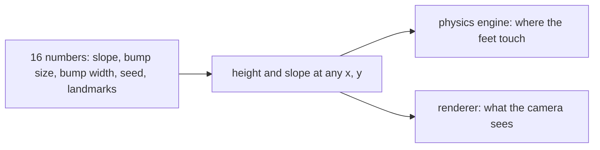

# The whole ground is a formula: an endless world in 64 bytes

*A fruit fly and a jumping spider now stand together on seeded terrain drawn by our own renderer, at five to ten frames a second.*

The ground our animals stand on is 16 numbers. Give the program a seed and it can tell you the height of the land at any point on a map of any size, a metre from the start or a kilometre. There is no terrain file to load and nothing to stream in as you walk.

That fits in 64 bytes. The version we replaced was a table of heights that took 256,000. This article is about that trick, and about everything we had to check before a fly could stand on it.

## Terrain as a formula, not a file

Minecraft does not store its mountains. It stores a seed, and works out the height at any spot when someone looks. We took the same idea one step further.

The height is a gentle slope plus a few layers of bumps, from broad hills down to fine texture. Both the physics engine and the renderer compute it from the same 16 numbers, so there is only one ground. Sixty-five thousand animals scattered over a kilometre cost no more memory for terrain than one.

Speed barely moves: looking up the ground costs less than 0.3 percent of a physics step at 65,536 animals.

We checked it the way we check everything. A second copy of the formula, written in Python as a referee, evaluated 100,000 random points against the GPU version: the height agreed to 5e-08, the slope to 6e-08. A planted bug, a changed constant in the hash that makes the noise, made the check fail.

Landmarks come from the same trick. Each 40-millimetre square of ground gets, at most, one cone 10 millimetres wide and 40 tall, decided by hashing the square's address with the seed. They are part of the ground formula, so the engine and the renderer both see them.

## Where the feet meet the ground

Under each body part, the engine treats the ground as a flat plane tilted to match the slope at that spot. On a straight ramp that is exact: we tested it against MuJoCo's own tilted-plane version at the 1e-05 bar. On bumps it is a different method from MuJoCo's heightfield contact. We measured the difference but did not make it a gate.

One ramp state failed, at 2.4e-04. It was not a conditioning problem. A contact in that state sat within float32 rounding of the point where it switches on, a coin flip. We exempt a state only when it fails and sits at such an edge, count each exemption, and the gate fails if more than 10 percent are exempted.

We also learned not to trust MuJoCo's heightfield for starting states. Its own rollouts on a sampled heightfield push the fly's thin feet through the ground: root at 2.05 mm, feet 0.81 mm below the surface.

## Does the fly stand? We built three gates before one worked

How much bumpiness can a fly take? We dropped it onto terrain and asked whether it was still upright after 300 frames. The fly stands on bumps 0.1 mm high with an 8 mm wavelength, and collapses onto its belly at 0.3 mm.

That sentence took three tries to earn. The first gate compared the body's up direction to vertical, and it failed the fly standing on flat ground, because the thorax frame is naturally pitched. The second used root height, and a fly lying on its belly on bumps sat inside the band. The third used "motors off" as the limp negative control, and that fly stood anyway, because joint angle zero is near a standing pose.

What fixed it was a rule: every gate runs a positive control that must pass (flat ground) and a negative control that provably fails (an upside-down start). The metric is chosen from measured values of both. The one we ended with is thorax clearance: 0.48 millimetres standing, 0.00 lying down.

We had also called the normal standing pose "tumbled" from one camera frame. A flat-ground frame for comparison settled it. A frame alone tells you nothing without a control.

## Our own renderer, drawing from the engine's memory

To see the fly we needed pictures. Using MuJoCo's renderer would mean copying every pose off the GPU each frame. So we wrote a renderer that reads the poses where they sit.

The fly is 69 parts and 115,158 triangles. Sixty-four flies are 7.4 million triangles per frame. The renderer draws them with a compute program: every triangle claims pixels with a single 64-bit number that packs depth, fly and triangle together, and the nearest one wins. Colour is worked out once per pixel at the end, not once per overlapping triangle. All the mesh data is stored once and every fly shares it, 1.1 MB in total.

Checks: we compared silhouettes against MuJoCo's own renderer, from the same pose and camera. The overlap score is 1.0 for identical shapes. Ours was 0.995 to 0.998 across three views. One fly at 960 by 540 pixels takes 0.57 to 1.0 milliseconds a frame. We also rendered 10,000 frames and watched memory, open files and GPU memory: all flat.

A cost we nearly missed: Mojo's GPU runtime reserved 22.7 GB of GPU memory per program by default. Turning that off brought the renderer to 152 MB, and the brain program kept the same speed.

## The spider shares the ground

A fly alone is a lonely world. We added a jumping spider. Its body is generated by a script: 23.5 milligrams, 64 joints, 58 motors, standing in MuJoCo. It is a hypothesis. No spider connectome exists, and its anatomy is approximate.

Putting two animals in one model brought a rounding problem. The spider stood 8 millimetres from the origin, which raised the float32 noise floor about a hundred times. Giving each animal its own floating origin removed the extra error the engine itself added: the spider passes with its origin 8 and 200 mm from the fly's, and a version that reuses the fly's origin fails at 200 mm. The noise from storing positions as float32 world coordinates stays.

Separate small tests, outside the engine, check a hypothesis model of the spider's vibration and eye circuits against published data. Those passes belong to the model, not to the physics.

## The live view works, and is still slow

`live.py watch 10 world` runs engine and renderer in one process and streams frames to a video window. At frames 1 and 300 we looked at it ourselves: both animals standing, cones behind them, nothing hidden. Released as v0.2.0.

It is not yet good. Each frame takes 96 to 196 milliseconds, five to ten frames a second. The camera is aimed once at the start and does not follow. The landmark cones are not wired to smell or vision. The world build has not had the long leak check. A spider-force mismatch between MuJoCo's merged and separate runs (7.3e-05) is unexplained.

The next gate, on the engine-finishing plan, is 25 frames per second with a following camera.

Next: [What we learned](06-what-we-learned.md).
